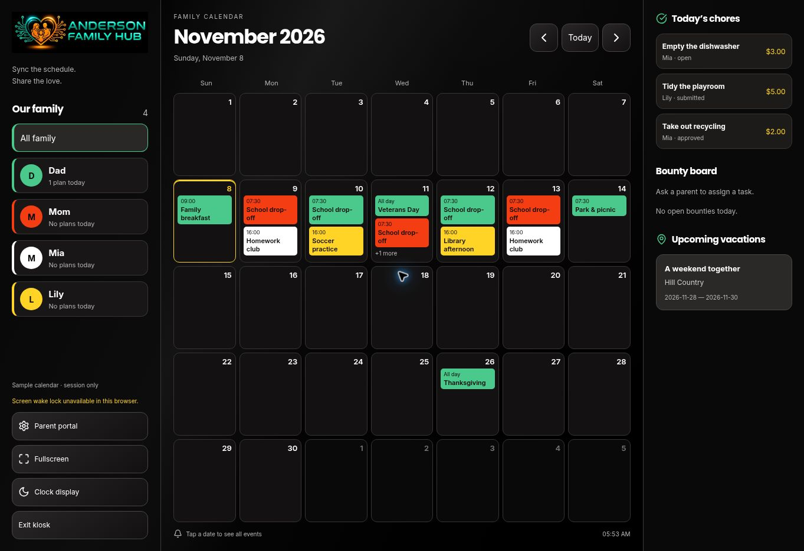

# Anderson Family Hub: Galaxy Tab S7 kiosk

## Scope

The tablet routes are `/kiosk` (authenticated family) and `/demo/kiosk` (sample records only). The regular workspace keeps its existing sections. The kiosk adopts the accepted glossy black, red, yellow, white, and green theme rather than the blueprint's placeholder slate/blue palette.

The landscape kiosk uses a 20% family column, 60% monthly calendar, and 20% activities column. It switches to stacked sections below 740 CSS pixels. Physical display resolution is not CSS viewport size: acceptance must also be checked on the actual Tab S7 at its chosen display scale.

## Features

- Actual Sunday-start monthly grids with complete weeks, including adjacent-month dates, leap years and cross-year holidays.
- Member color tabs and today's plan counts. These counts are calendar status, not physical presence tracking.
- Tap a day for all events, locations and notes; navigate months or return to Today.
- Today's assigned chores, unassigned open bounties, and upcoming/in-progress vacations.
- Event alerts during their scheduled local minute while the calendar is awake. Alerts respect the selected member and show the actual due records. Alerts are not push notifications or guaranteed background alarms.
- A 15-second inactivity clock with seconds, local date, and the next two upcoming family events. Touch/click or a key wakes the display. Modals pause inactivity; background controls are inert under modals and the screensaver.
- Inter UI, Poppins headings, and Space Grotesk tabular clock numerals, with local fallback fonts. Interactive controls have 48px minimum dimensions.
- Fullscreen and wake-lock requests with an explanatory fallback if the browser refuses them.

## Existing data architecture

No parallel `family_members`, `events`, `chores`, or `vacations` tables are created. The app already stores these in `public.planner_records` under family RLS.

| Blueprint concept | Existing record kind | Data fields |
| --- | --- | --- |
| Member | `member` | `title`, `role`, `color` |
| Calendar event | `event` | `title`, `date`, `time`, `member`, `location`, `notes` |
| Chore | `chore` | `title`, `date`, `member`, `assigned_user_id`, `status`, `amount`, optional `points` |
| Open bounty | `chore` | No assigned user, empty/`Family` member, `open` status |
| Vacation | `trip` | `title`, `location`, `date`, `end` |

Parent-created records appear automatically. Use the regular parent workspace to create/edit plans and assign bounties. Existing member color keys are retained; the tablet renders their accepted reference colors. Sample records are ephemeral and do not write to Supabase.

## Security and synchronization

The display fetches only member/event/chore/trip records for the signed-in family. Existing database RLS remains authoritative. The shared display does not approve, pay, edit or claim chores. A child signed into their own account may submit only an open chore whose `assigned_user_id` matches their authenticated UUID, through `submit_planner_chore`.

The blueprint's local `1234` PIN is deliberately omitted. The Parent portal control explains access and opens the existing workspace, where the actual signed-in role governs editing. This is not a PIN-protected parent session: use a least-privilege family member account on a shared tablet. An admin session retains admin privileges outside the kiosk route.

Migration `20261108114844_enable_planner_kiosk_realtime.sql` adds only the existing planner table to `supabase_realtime`. No grants or RLS policies change. Family-filtered INSERT/UPDATE notifications trigger a fresh authorized snapshot. Reconciliation every 15 seconds handles deletions and missed/disconnected changes; reconnect and visibility changes refresh the snapshot. Failed sync retains only the same family's last snapshot with a visible warning. Records are not cached offline by the service worker.

## Installation and device acceptance

After this branch is released, open `/kiosk` on the tablet, sign into its family member account, then install the web app using the browser's install/add-to-home-screen option. The kiosk-specific manifest uses landscape standalone mode, a black launch background, and 192/512px maskable PNG icons. Installing from the sample route still launches the real `/kiosk` route.

Standalone mode hides normal browser chrome. It does not prevent exiting the app or take over Android. OS app pinning/managed kiosk configuration must be completed on the actual device. Fullscreen, wake lock, orientation, idle behavior, network reconnection, scaling and installation remain device acceptance checks.

## Verification

- 13 Node tests pass, including leap years, 28/35/42-day grids, month navigation, upcoming ordering, invalid/past events, bounty assignment safety, and existing planner tests.
- Vite production build passes.
- Rollback-only database tests pass for child submission, reward protection, finance privacy, cross-family isolation, role protection and parent approval. No test users or records remain.
- Database inspection confirms the planner table is published for Realtime and RLS remains enabled.
- Browser sample checks: member filtering, all-event day details, month navigation, Today, parent-access dialog, automatic idle clock, ticking seconds, keyboard wake, and 48px targets. At the observed 1363×936 viewport, columns were 272.6/817.8/272.6px with no document overflow.
- Source review resolved stale-family snapshot exposure and mismatched alert filtering. The regular App change is only the kiosk prop wiring.
- Authenticated browser-to-database Realtime delivery, real child button submission, offline recovery, scheduled alerts, and physical Tab S7 behavior still require acceptance testing. The passing SQL suite verifies database permissions, not those browser flows.

Existing Supabase advisories remain unchanged: four intentional authenticated security-definer RPC notices and disabled leaked-password protection. See [RPC advisory guidance](https://supabase.com/docs/guides/database/database-linter?lint=0029_authenticated_security_definer_function_executable) and [password protection guidance](https://supabase.com/docs/guides/auth/password-security#password-strength-and-leaked-password-protection).

