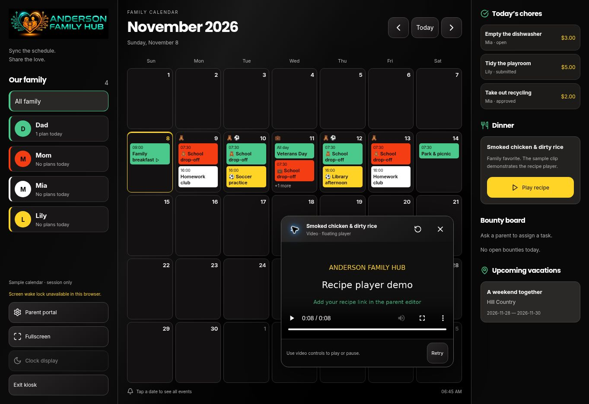

# Floating videos and calendar layers

## Use

In the parent workspace, add/edit an event and choose Work, Daycare or Activities. Existing categories remain available. The optional Video URL field accepts HTTPS YouTube, Vimeo, MP4 or WebM links. Meals have an optional Recipe video URL field. Only Dinner meals for the tablet's current local date appear below chores in the kiosk.

Tap **Play recipe** in Dinner, or tap a calendar date and then **Play event video**. A video indicator identifies calendar events with playable attachments. Category icons are shown on dates and event cards without replacing family member colors.

The floating window is an in-app player, not an OS Picture-in-Picture window. Drag its grip with a finger or mouse. Focus the grip and use arrow keys to move 24px, or Home to reset. Reset and Close controls are at least 48px. Dragging is confined to a 12px viewport inset; resizing resets the window to a visible position. Native/embedded player controls are not drag handles.

The idle screensaver and manual Clock display are suppressed while the window is open, including when paused or ended. Closing restarts the 15-second idle period. Opening another calendar dialog hides/pauses the player; playback can be resumed with its controls afterward. Household changes immediately unmount old media. Closing/removing a video pauses it during any exit animation. Realtime snapshot refreshes preserve unchanged playback; removing a record or changing its source closes the old player.

## Data and dependencies

No SQL schema migration is required. Existing family-scoped `planner_records` already supports `meal` and `event`. Both store optional `data.video_url`; events already store `data.category`. The kiosk's authorized snapshot now includes `meal`. The existing planner Realtime publication covers those records automatically, including edits; 15-second reconciliation still handles deletions and reconnects.

Parents can write only after a server-verified Parent Portal unlock; RLS enforces the session-bound grant. Children have read-only meal/video access and cannot change recipe links, categories or assignments. Meals stay in existing family-scoped planner records. No default or client-only PIN is used.

`react-player` is pinned to **2.16.1**, compatible with the project's React 18 and `react-player/lazy`/`url` API. Framer Motion was already installed. Provider player modules load lazily. Preserve the lockfile with `npm ci`; an unpinned upgrade to ReactPlayer v3 requires an API migration. The existing Speed Insights dependency and locked package are preserved.

The URL helper validates on save and again before playback. It rejects non-HTTPS schemes, credentials, deceptive hosts, unsupported page URLs and malformed IDs. Supported provider links normalize to YouTube/Vimeo URLs; unlisted Vimeo privacy hashes are preserved. Direct MP4/WebM query strings, including signed URLs, remain intact. The only permitted internal path is `/demo-recipe.mp4`, a small generated sample clip demonstrating the player rather than an actual cooking tutorial. Video services are contacted only after Play is selected.

## Playback limitations and recovery

Videos must be embeddable and accessible from the tablet's network. Age restrictions, provider login requirements, DRM, private permissions and disabled embedding can prevent playback. Browser autoplay policies may require tapping the player's Play control. The player displays an error or slow-loading message and provides Retry and Close. It does not navigate away from the calendar or automatically enable native PiP.

## Verification

- 19 Node tests pass, including URL schemes, credentials, deceptive domains, YouTube/Vimeo variants, signed direct URLs, unlisted Vimeo hashes, category normalization, and existing calendar behavior.
- Clean `npm ci` and the production build pass; existing dependency locks are unchanged apart from the ReactPlayer addition and its dependencies.
- `tests/meal-video-rls.sql` passes in a rollback-only transaction: parent authoring, child read-only access, category persistence and cross-family isolation. No fixture users/records remain.
- Browser: today's dinner appears, tomorrow's dinner does not; category indicators render; native MP4 reaches its 8-second duration; recipe and event launch work; event dialogs close before playback; only one active player is exposed.
- Browser: mouse dragging, edge constraints, arrow-key movement, Reset and 48px app controls verified. Player remained open without the idle overlay; close restored the clock control and idle screensaver.
- Browser: an unsupported page URL was rejected in the parent editor; a supported YouTube URL saved in the sample workspace. Temporarily removing the local demo asset produced the playback error; restoring it and Retry recovered playback.
- External YouTube/Vimeo playback, physical tablet touch, rotation/resize, and live authenticated browser updates still need acceptance on the actual Tab S7. Native MP4, source validation and database RLS checks do not prove those external-provider/device flows.

